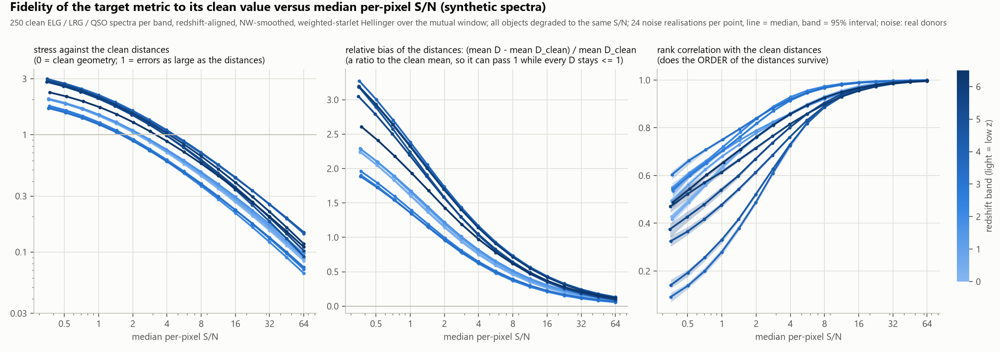

# Metric fidelity versus S/N, projected onto DR2

Code: `src/DESIFlow/metric/` (`hellinger.py` the metric, `synth.py` the clean synthetic spectra, `fidelity.py` the simulation, `dr2_projection.py` the DR2 projection, `plots.py` the figures); tests `tests/test_metric_fidelity.py`; job script `slurm/metric_fidelity_dr2_perlmutter.sbatch`.

The question: how faithful is the target metric to its own clean value as the median per-pixel S/N falls, and what does that mean for DR2 at different S/N cuts and redshifts? It is answered in two independent parts. **The metric is never run on DR2**: the survey enters only through the median per-pixel S/N of its spectra.

## 1. Simulation: the fidelity curve (`python -m DESIFlow.metric.fidelity`)

Per redshift band (the metric lives on a z-banded interval graph; default bands `0, 0.1, 0.25, 0.4, 0.6, 0.8, 1, 1.25, 1.5, 2, 2.5, 3, 4, 6.5`):

1. **Clean suite.** `--n-suite` (250) noise-free physics-linked synthetic spectra (ELG / LRG / QSO, `metric/synth.py`, ported from the benchmark generator; classes are drawn when their natural redshift reach overlaps the band, weights `--classes 0.5 0.2 0.3`) with redshifts inside the band.
2. **Clean target.** The metric between all pairs of the clean suite: integer log-pixel shift to the rest frame, 77 km/s NW smoothing with ivar weights, weighted starlet (J = 8, s1 dropped, positive / negative masses), compositional Hellinger over the pair's *mutually good* rest-frame pixels (the composition is renormalised to that window). This distance matrix D0 is the target.
3. **Degrade and measure.** Every object gets Gaussian noise with a relative noise profile scaled so that the median per-pixel S/N (median of `flux * sqrt(ivar)` over the good pixels) equals the target S/N; the metric is recomputed among the degraded objects (all at the same S/N, independent noise) and compared with D0:
   * **stress** = sqrt( sum_{i<j} (D - D0)^2 / sum_{i<j} D0^2 ) (Kruskal stress-1: 0 = the clean geometry, 1 = errors as large as the distances); `fidelity = 1 - stress`;
   * **bias** = (mean D - mean D0) / mean D0, a RELATIVE bias (the noise floor makes the distances too large). It is a ratio to the clean mean, so it can exceed 1 although every Hellinger distance stays <= 1: for z 0.4-0.6 the clean mean is D0 = 0.19 and the noisy mean D = 0.23 / 0.32 / 0.47 / 0.60 at S/N 16 / 4 / 1 / 0.35 (maximum 0.71), i.e. a bias of +0.24 / +0.68 / +1.5 / +2.2. Stress is relative in the same way (to sqrt(sum D0^2)) and can pass 1;
   * **rank correlation** (Spearman) of D with D0: does the *order* of the distances survive.
4. **Many realisations, then lower S/N.** `--reps` (24) independent noise realisations at each S/N give the confidence interval (2.5-97.5%); the S/N is stepped down (`--snr`, default 64 to 0.35 in steps of sqrt(2)) and the sweep repeated. The result is the stress / bias / rank-correlation curve versus median per-pixel S/N of each band (`fidelity.json`, `fidelity_curves.csv`, `fidelity_vs_snr.png`).

Noise profile: by default a built-in DESI-like relative profile (rising toward both ends of the spectrograph range, bumps at the strongest sky lines); `--noise-donors <dir>` uses the relative noise pattern (`1 / sqrt(ivar)` over its median) of random real spectra instead (the DR2 set on NERSC), and `--use-masks` also applies their masks to the clean baseline and the degraded copies alike. The S/N axis is the *realised* median per-pixel S/N of the noisy spectra (a few percent below the target below S/N 4), the same estimator the survey uses.

## 2. Projection onto DR2 (`python -m DESIFlow.metric.dr2_projection`)

One streaming pass over the memory maps measures the median per-pixel S/N (`training.data.object_snr`) and the good-pixel fraction of every spectrum (cached in `snr_all.npz`). Per redshift bin (default: the bands of the fidelity file) and S/N cut c (`--cuts`, 0 = no cut):

* **completeness** = objects with S/N >= c over the objects of the bin;
* **projected fidelity**: the bin's stress curve read at the **median S/N of the kept objects**, with the curve's confidence interval at that S/N; the spread of the kept population (the curve at its 84th and 16th percentile S/N) and the per-object expectation (the curve averaged over the kept objects) are tabulated too; S/N outside the simulated range is clamped (`frac_outside`);
* **S/N cut needed**: the faintest S/N at which the median stress curve reaches each target (`--stress-targets`, default 0.2 / 0.4 / 0.6) and the completeness at that cut, also with the pessimistic (97.5%) curve.

Pooled all-z rows weight the bins by the number of kept objects.

## Run it

```bash
export PYTHONPATH=$PWD/src
python -m DESIFlow.metric.fidelity --out <out>/fidelity [--noise-donors <dir>] [--z-edges ...] [--snr ...]      # GPU or CPU; minutes on a GPU
python -m DESIFlow.metric.dr2_projection --data-dir <dir> --fidelity <out>/fidelity/fidelity.json --out <out>/projection
python -m DESIFlow.metric.plots <fidelity.json | projection.json>                                              # redraw a figure from a finished run
python tests/test_metric_fidelity.py                                                                            # CPU, ~2 min
```

On NERSC (one GPU node; stage 1 simulates with the DR2 spectra as noise donors, stage 2 streams ~60 GB once):

```bash
sbatch -A <project>_g -q debug -t 00:30:00 --export=ALL,ENV_CMD="module load pytorch/<version>",MAX_ROWS=20000,N_SUITE=100,REPS=4,OUT=$SCRATCH/metric_snr/debug slurm/metric_fidelity_dr2_perlmutter.sbatch   # check
sbatch slurm/metric_fidelity_dr2_perlmutter.sbatch                                                                                                                                      # production
```

Defaults: `DATA=$SCRATCH/V2_Real/pretraining_data`, `OUT=$SCRATCH/metric_snr/dr2`, `DONORS=1`, `N_SUITE=250`, `REPS=24`; `FIDELITY=<fidelity.json>` skips stage 1 (a curve made on a laptop can be shipped: it is a small JSON); `EXTRA_FID` / `EXTRA_PROJ` pass further options. The log is `metric_fidelity_<jobid>.out`; resubmitting continues (`--resume`).

## Outputs

| file | content |
|---|---|
| `fidelity/fidelity.json`, `fidelity_curves.csv` | per band and S/N: realised S/N, stress / bias / rank correlation with their 2.5, 16, 50, 84, 97.5% values, `fidelity_p50`; per band the class counts, the number of pairs, the median clean distance and nearest-neighbour distance |
| `fidelity/fidelity_vs_snr.png` | the figure: stress, bias and rank correlation versus median per-pixel S/N, one line per redshift band |
| `projection/projection.csv`, `projection.json` | per (z bin, cut) and pooled: `n_bin, n_kept, completeness, snr_median_kept, snr_p16/p84_kept, stress, stress_ci_lo/hi, stress_pop_lo/hi, stress_mean_obj, fidelity, frac_outside`, and the band whose curve was used |
| `projection/snr_cut_needed.csv` | per bin and stress target: the S/N cut that reaches it, the completeness there, and the pessimistic-curve versions (blank: never reached by S/N 64) |
| `projection/projection_vs_z.png` | completeness, projected stress, kept median S/N, S/N cut needed, completeness at that cut, objects kept, each versus redshift |
| `projection/snr_all.npz` | S/N, good-pixel fraction and z of every object (reused on resubmission) |

## Result of the local simulation (13 bands, 250 clean spectra each, 24 realisations, noise profiles of 99 real DR1 spectra)



`figures/fidelity_dr1_donors.json` holds the curves (it can be passed to `dr2_projection --fidelity` as is; the DR2 run simulates its own with DR2 donors). Median stress against the clean target:

| band | classes (ELG / LRG / QSO) | S/N 32 | 16 | 8 | 4 | 2 | 1 | rank corr. at S/N 4 / 1 |
|---|---|---|---|---|---|---|---|---|
| 0-0.1 | 181 / 69 / 0 | 0.15 | 0.27 | 0.44 | 0.70 | 1.05 | 1.45 | 0.86 / 0.64 |
| 0.4-0.6 | 185 / 65 / 0 | 0.17 | 0.30 | 0.48 | 0.75 | 1.09 | 1.47 | 0.86 / 0.70 |
| 0.8-1 | 142 / 45 / 63 | 0.13 | 0.23 | 0.38 | 0.61 | 0.91 | 1.27 | 0.91 / 0.71 |
| 1.25-1.5 | 163 / 0 / 87 | 0.25 | 0.43 | 0.71 | 1.10 | 1.61 | 2.18 | 0.73 / 0.28 |
| 2-2.5 | 0 / 0 / 250 | 0.18 | 0.34 | 0.60 | 0.99 | 1.50 | 2.11 | 0.76 / 0.48 |
| 4-6.5 | 0 / 0 / 250 | 0.20 | 0.35 | 0.57 | 0.88 | 1.27 | 1.71 | 0.86 / 0.66 |

* The stress falls as a power of S/N (about S/N^-0.85 between 32 and 16, S/N^-0.6 between 4 and 2) and is **mostly bias**: the noise floor inflates every distance (bias +1.0 to +1.7 of the mean clean distance at S/N 2), while the order of the distances survives much longer (rank correlation 0.73-0.93 at S/N 4).
* Even at S/N 32 the stress is 0.12-0.26; at S/N 2-4 the noisy distances are wrong by about as much as the distances themselves (stress ~ 0.6-1.6), and below S/N ~ 1 the bands whose spectra carry few lines inside the window (the ELG + QSO bands at z 1.25-2, where few ELG lines fall inside the window) lose the order too (rank correlation 0.28-0.33).
* Redshift matters, presumably through the rest-frame content inside the window and the class mix: the bands with LRG / QSO features (0.6-1.25) are the most faithful, the ELG + QSO bands at 1.25-2 the least.
* The confidence interval over noise realisations is very narrow (95% width ~ 0.004 in stress at S/N 4: 31 125 pairs average the noise out); the uncertainty that matters is the choice of clean suite and noise profile (see the caveats).
* DR2's median S/N is 1.8 (10-90%: 0.5-7.2): read at S/N ~ 2 the simulation says the typical DR2 pair distance is wrong by about 100% (stress 0.9-1.6), so an S/N cut or the S/N-dependent edge weights of the stitch decide how much of the geometry is usable; the projection table gives the exact numbers per redshift bin and cut.

## Caveats

* The curve is for **synthetic ELG / LRG / QSO** spectra (no stars, no Lyman-alpha forest, so z > 2.5 QSOs are cleaner than real ones); DR2's spectral-type mix per redshift differs. The noise pattern matters: with the relative noise profiles of 99 real DR1 spectra instead of the analytic profile the stress at a given S/N is higher by ~30% at S/N 8-32 and 15-25% below S/N 4 (band z 0.4-0.6: stress 0.127 -> 0.167 at S/N 32, 0.587 -> 0.733 at S/N 4, 1.26 -> 1.46 at S/N 1), so use the DR2 donors for the DR2 projection (the job script does).
* All objects of a simulated suite share one S/N. A pair's noise floor goes roughly as `1/s_i^2 + 1/s_j^2`, so a real sample with a spread of S/N is approximated by the curve at its median S/N (the population and per-object columns bracket this); the S/N spread of the sample above a low cut is large.
* The confidence interval is the spread over noise realisations of one clean suite per band; it does not include the variance between suites (change `--seed` / `--n-suite` to see it).
* Stress is a global measure over all pairs of the bin; the stress of a particular object's neighbourhood can differ (nearest neighbours have small D0 and are the first to be lost to the floor).
